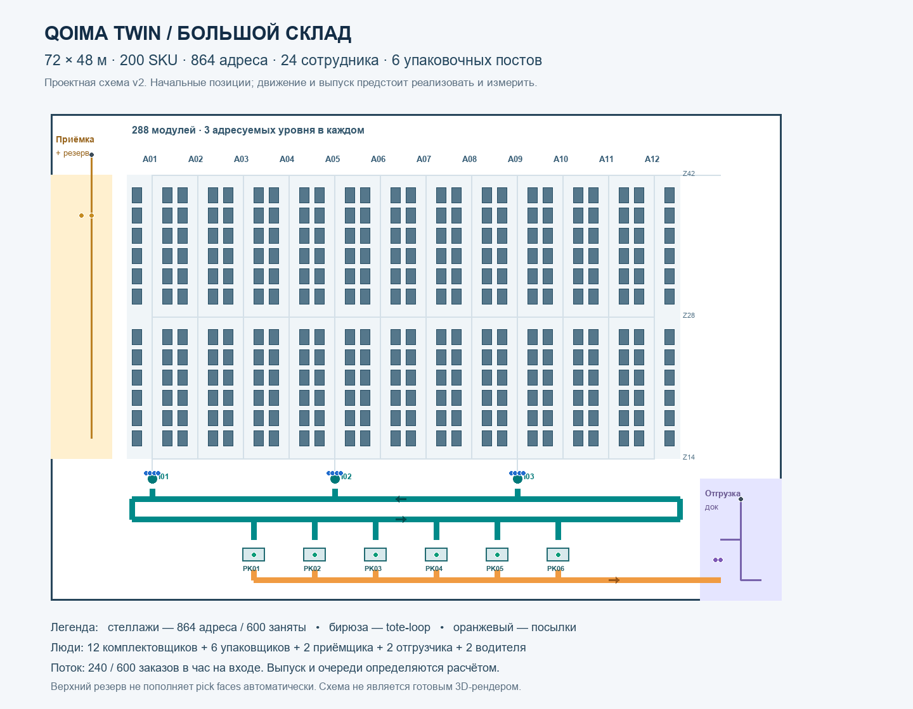

# QoimaTwin

**Основной проект — цифровой склад 72×48 м:** 200 SKU, 864 адреса хранения, 24 сотрудника, шесть упаковочных постов и конвейерный поток от комплектации до отгрузки.

Реализован visual frontend v2: большая 3D-сцена, 21 семейство моделей, 24 сотрудника, конвейеры, управление камерой и детерминированное воспроизведение. Начальный режим **VISUAL DEMO / synthetic** показывает небольшой сценарий в полной геометрии склада. Это визуальная фикстура, а не результат расчётного ядра или доказательство эффективности склада.

**Тилек** отвечает за Blender/GLB, frontend, визуальное воспроизведение и его проверки. **Арман** — за бизнес-логику, архитектуру и расчётное ядро. Backend развивается отдельно: в ветке `arman/backend-core` на `5a0be9d` есть one-order engine и работа со snapshots/chunks. Эта ветка не объединена с visual frontend; совместимый Run exporter, API и массовый поток ещё не приняты. Прогноз для 200 SKU, текущий ledger, операционные KPI и A/B не подключены к viewer. Статус передачи — [BACKEND_HANDOFF.md](docs/visual/BACKEND_HANDOFF.md).

## Что изменилось

Прежнее ТЗ ограничивало склад размером 20×18 м, 20 SKU, двумя комплектовщиками и одним упаковщиком. Новая площадь больше в 9.6 раза, ассортимент — в 10 раз. Модули приложенного архива ассетов переиспользуются с сохранением реальных размеров людей и оборудования.

| Часть | Обязательный масштаб v2 |
|---|---|
| Хранение | 12 проходов × 12 секций × 2 стороны × 3 уровня = 864 адреса |
| Товары | 200 активных SKU; с резервом заняты 600 адресов |
| Люди | 12 отборщиков, 6 упаковщиков, 2 приёмщика, 2 отгрузчика и 2 водителя: всего 24 |
| Оборудование | 2 погрузчика, 3 индукции, 6 упаковочных постов, 2 дока |
| Конвейеры | Замкнутая линия tote длиной 112 м, подачи, ответвления и выход; всего 179 ячеек по 1 м |
| Входной поток | Normal: 240 заказов/ч; Peak: 600 заказов/ч. Выпуск рассчитывается, а не задаётся |
| Данные | Синтетический ассортимент 200 SKU; исторический UCI-срез 20 SKU хранится отдельно |
| Сравнение | Одинаковые заказы и ресурсы; меняется размещение с учётом оплаченного плана переносов |

## Навигация

| Материал | Содержание |
|---|---|
| [Подробное ТЗ v2](01_Technical_Specification.md) | Объём, операции, остатки, AI, архитектура и API |
| [PDF для команды](Qoyma_Twin_TZ_and_48h_Plan.pdf) | ТЗ, сцена, план работ и приёмка |
| [3D и replay: Тилек](03_3D_Scene_and_Replay.md) | Ассеты, instancing, LOD, сцена и визуальные проверки |
| [Текущее состояние visual frontend](docs/visual/NIGHT_STATUS.md) | Реализованная визуальная часть и граница готовности |
| [Воспроизведение и интеграция](docs/visual/MOTION_AND_INTEGRATION.md) | Визуальная фикстура, Run v2 adapter, позы, эффекты и ограничения |
| [Проверка моделей](docs/visual/MODEL_QA.md) / [GLB в браузере](docs/visual/BROWSER_MODEL_REVIEW.md) | Отдельные ракурсы, конструкция и свидетельства проверки |
| [Работа вдвоём за 48 часов](04_Work_Packages_48h.md) | Ответственность, часы, интеграция и сокращение объёма |
| [Контракты v2](contracts/README.md) | Геометрия, 24 сотрудника, остатки, схемы и ручная фикстура |
| [Приёмка и демо](05_Acceptance_and_Demo.md) | Масштаб, арифметика, поток и корректность сравнения |
| [Миграция и аудит ZIP](07_Scale_Migration_and_Asset_Audit.md) | Причина пересмотра, сохранение работы и адаптация ассетов |
| [Репозитории](02_Repositories_and_Research.md) | Доноры, лицензии и ограничения |
| [Исследование 20 SKU](06_Data_ML_and_Feasibility.md) | Результаты v1, которые не являются проверкой большого склада |
| [Термины](GLOSSARY.md) | Общий предметный язык |
| [Данные v1](data/) / [скрипты](tools/) | Агрегаты UCI и исследовательские проверки |
| [Контракты legacy](contracts/legacy-v1/) | Прежняя модель для проверки арифметики |
| [Источники](THIRD_PARTY_NOTICES.md) | Атрибуция данных и сторонних материалов |

## Запуск visual frontend из исходников

Нужны Node.js 22.12 или новее, npm и браузер с WebGL. Из корня клонированного репозитория:

```powershell
git clone https://github.com/tilekkz/QoimaTwin.git
cd QoimaTwin/frontend
npm.cmd ci
npm.cmd run dev
```

Откройте адрес localhost, напечатанный Vite. На Windows `npm.cmd` позволяет запускать команды без изменения PowerShell execution policy; в других оболочках используйте `npm`. Если репозиторий уже открыт, достаточно перейти в его `frontend/`.

Сборка frontend:

```powershell
npm.cmd run build
```

Команда включает TypeScript-проверку и создаёт `frontend/dist/`. Для готового итогового пакета root укажет проверенный запуск через `START_VIEWER.ps1` в его `README_MORNING.md`; это отдельный способ запуска собранного viewer.

В viewer доступны общий обзор, зоны потока/приёмки/отгрузки, миникарта, выбор адреса, следование сотруднику и заказу, отдельный осмотр моделей с четырьмя ракурсами, галерея референсов, Low/High и reduced motion. Воспроизведение поддерживает play/pause, reset, seek и скорости 1×/10×/30×/60×. Звук изначально выключен и включается действием пользователя.

Кнопка **«Открыть Run v2»** принимает совместимый inline JSON через frontend adapter. Это не подключение готового backend API. Неподдержанные или отсутствующие размещения грузов показываются как предупреждения; остатки и KPI не вычисляются клиентом. Подробности — в [границе интеграции](docs/visual/MOTION_AND_INTEGRATION.md).

Оба участника продолжают работу от актуальных ТЗ, контрактов и плана 48 часов. Арман реализует полный цикл с конечной вместимостью конвейеров, упаковки и отгрузки; visual frontend подготовлен для подключения его результатов.

В первый час согласовать `schema_version=2.0`, `layout_version=qoima-72x48-v2`, ресурсы и события. `analytical_fixture.json` содержит ожидаемые числа, а не экспорт готового движка. Старый `hand_checked_run` не подходит как итоговый runtime для 200 SKU.

Для слабой видеокарты реализованы один viewport, instancing повторяющихся объектов, дальние LOD и режим Low. Размеры склада и все 24 сотрудника сохраняются. A/B будет подключён при наличии двух совместимых расчётных результатов. [InstancedMesh](https://threejs.org/docs/pages/InstancedMesh.html) повторяет общую geometry/material с разными transforms.

## Что готово и что предстоит

Layout материализован и используется сценой: 184 узла, 205 рёбер, 288 стеллажей, 864 адреса и 179 конвейерных ячеек. Канонический пример содержит 600 партий с 600000 единицами товара. В карточке адреса viewer подписывает количество как **начальное**; это не воспроизведение текущего inventory ledger.

Поставлены 21 семейство моделей с индивидуальными `.blend`/GLB и превью, редактируемая большая сборка и калибровочная сцена. Визуальное воспроизведение показывает путь tote → parcel → pallet → dispatch, независимую приёмку, водителей внутри двух машин и явную остановку груза на ленте. Позы, ручные service connectors и короткая блокировка сценария служат проверке 3D. Фикстура не моделирует входной поток 240/600 заказов в час, конечные очереди, баланс товара или экономический эффект.

Полноценная интеграция DES/ledger, прогноза и планировщика для 200 синтетических SKU, операционных KPI, A/B и потоковой доставки Run остаётся следующей совместной работой с Арманом. Текущие shared contracts сохраняют версию 2.0; предложение 2.1 не применяется к viewer автоматически. Исследовательские результаты v1 ниже сохраняют собственную область применимости.

После финальной поправки камеры root повторил frontend regression: **30/30 за 31,8 с**. Независимая проверка охватывает 23/23 экспортов, Khronos validation — 33/33 GLB без errors/warnings. Повторный performance checkpoint от 06.11.2026 22:29:17 UTC содержит два 60-секундных окна в **Headless Chrome 156, Intel UHD/D3D11, 1366×768, Low, DPR 1, replay 10×, mute**:

| Режим | Median / mean FPS | p95 frame time | Max calls / triangles |
|---|---|---|---|
| Общий обзор | 142,86 / 100,83 | 14 мс | 154 / 270 248 |
| Следование P01 | 140,85 / 99,38 | 14 мс | 191 / 418 632 |

Это измерения на указанном устройстве и двух сценарных окнах. Вблизи превышены мягкие ориентиры 180 calls / 350k triangles; цифры не означают одинаковый FPS на любой GPU и не измеряют пропускную способность склада. После поправки камеры root обновляет 90-секундную запись/пять action clips под последнюю сборку. Media verification следует читать в отчётах ниже; выпуск пакета ещё завершается.

| Свидетельство | Артефакт |
|---|---|
| Итоговые проверки frontend | [BROWSER_QA.json](docs/visual/BROWSER_QA.json) |
| Измерения на устройстве | [PERFORMANCE.json](docs/visual/PERFORMANCE.json) |
| Проверка экспортов | [GLB_VALIDATION.json](docs/visual/GLB_VALIDATION.json) и [manifest](assets/v2/asset-manifest.json) |
| Реальная запись viewer | Source: `work/night-video/QoimaTwin_Night_Demo.mp4` и `work/night-video/poster.png`; итоговые файлы и инструкция `README_MORNING.md` находятся в корне готового пакета |
| Сводная приёмка и ограничения | [FINAL_REVIEW.md](docs/visual/FINAL_REVIEW.md) |

Статус проверки итогового видео, запуска `START_VIEWER.ps1`, hash готового пакета и финального frontend commit указывает root в отчётах поставки. Готовность пакета и публикации здесь пока не заявлена.

## Данные и границы результатов

Исторический UCI-срез содержит 749 частичных корзин, 1745 посещений SKU и 30399 единиц товара. Выбранные 20 SKU покрывают 3.79% посещений исходного ассортимента. Дневной HGB дал WAPE 38.957% против 38.850% у mean28; преимущества не получено. При сильном ABC и полной цене переносов планировщик v1 выбрал no-op на всех 20 днях и четырёх пятидневных окнах.

Эти числа относятся к старой геометрии. Новый большой сценарий 200 SKU маркируется как **synthetic**. Отдельная выгрузка 200 реальных UCI SKU ещё не подготовлена; увеличение числа видимых коробок не расширяет реальный датасет.

`tools/prepare_data.py` и `tools/qoyma_decision_probe.py` сохранены для воспроизводимости v1. Они не создают runtime v2. Исходный XLSX доступен в [официальном ZIP UCI 502](https://archive.ics.uci.edu/static/public/502/online+retail+ii.zip); хеш и фильтры указаны в `data/data_manifest.json`.

В `donors/` находится исходный код визуального донора с лицензией MIT. Оригинальный пользовательский ZIP сохранён как источник; его аудит описан в документе 07. Актуальные v2-модели и их происхождение перечислены в [manifest](assets/v2/asset-manifest.json) и [SOURCES_AND_RIGHTS.md](docs/visual/SOURCES_AND_RIGHTS.md).

## Если не укладываемся

Для снижения графической нагрузки используются Low, дальние LOD, spatial culling и ограничение теней/подписей; ближние модели сохраняют проработанную геометрию. Второй viewport остаётся дополнительным режимом после измерения. Основной склад не уменьшается до 20 SKU; визуальная фикстура и настоящий расчёт подписываются отдельно, декоративные KPI не подменяют результаты.

## Схема и проверка материалов



Эта схема иллюстрирует каноническую планировку; интерактивная 3D-сцена запускается командами выше. Для воспроизведения проверок контрактов: установить `tools/requirements-spec.txt` в своё окружение и выполнить `python tools/validate_spec_v2.py`. Валидатор проверяет материалы и аналитическую арифметику, а не DES или работу браузерного viewer.
