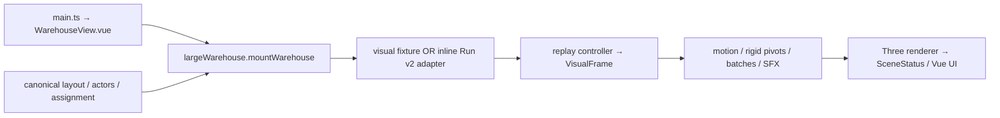

# I04 — Current frontend/replay inputs and V3 boundary

Read-only map, 2026-11-07. Baseline: I01 PASS, checkout
`codex/twin-environment@10496fd4ccd748676c036c371dd1a29881f046d1`, including the
preserved newer dirty V2 sources. This describes current V2, not implemented V3.
Only this map and the I04 card were edited.

| Boundary | Actual source and inputs | Current behavior / owner |
|---|---|---|
| Entry and modes | `frontend/src/main.ts`; `app/WarehouseView.vue` | `createApp` mounts WarehouseView directly. Normal mode dynamically imports `scene/largeWarehouse.ts`. `?calibration=v2` selects `app/CalibrationV2.vue`; other `?calibration` selects legacy `app/App.vue`. App.vue is not the normal entry. Tilek owns UI. |
| Mount and geometry | `scene/largeWarehouse.ts::mountWarehouse`, `assetCatalog`, `buildOverview` | Direct imports of `layout`, `actors`, `assignment` through `frontend/src/contracts/index.ts`. Enforces schema `2.0` and layout `qoima-72x48-v2`. Loads 21 catalog GLBs from `BASE_URL + models/v2/`, checks exported asset/layout metadata, builds racks/lots/cells/stations, owns camera, one renderer/RAF, selection/follow, quality/LOD and disposal. References use `BASE_URL + references/`. |
| Source | `replay/fixture.ts::createVisualFixture`; `replay/adapter.ts::adaptRunV2` | Mount starts the explicit 500-second `visual-fixture-v2-001`. Fixture imports the same layout/actors/assignment, uses canonical graph edges plus labelled visual service connectors and scripted timing/hold. UI file import calls `viewer.loadRun(JSON)`; switching source resets clock, audio and follow/selection. |
| Actor/cargo state | `replay/types.ts`; `scene/warehouseMotion.ts::createWarehouseMotion`; `scene/riggedModel.ts::createRiggedModel` | `VisualRun` holds actors, action intervals, events, cargo states/motions/attachments and blocked windows. `VisualFrame` supplies positions, stages and poses. Presentation binds known roles and `tote/parcel/pallet/lot` to models, keeps four nearby hero actors articulated and other actors visible through batches/LOD. Driver, cart and service offsets are presentation bindings; logical positions remain separate. |
| Clock and events | `replay/core.ts::createReplayController`, `compileVisualRun`, `samplePath`, `sampleCargoPath` | Absolute seconds; RAF delta advances only while playing, multiplied by speed up to 60. Actions are `[start_s,end_s)`; events sort by `(at_s,phase,seq)` and apply through the clock. Binary-search indexes support seek/reset. Cargo parent resolution is independent of track order; turn easing preserves the timed centreline. Controller currently requires exactly 24 unique actors. |
| UI/audio boundary | `WarehouseView.vue`; mount's returned viewer API; `replay/sfx.ts` | UI calls play/pause/seek/reset/speed, source import, camera/follow, quality, reduced motion and sound controls. Status is a Vue callback; `window.__QOIMA_VIEWER__` exposes the same viewer plus QA inspection. SFX starts muted, unlocks by gesture, uses forward crossings and clears on discontinuity. |

**Canonical shared inputs for I05**

`frontend/src/contracts/index.ts` directly re-exports these current shared files:

- `contracts/layout.example.json`: metres, seconds, right-handed Y up; bounds
  `[0,0,0]..[72,8,48]`; 288 racks, 864 slots, three inductions, six packing stations,
  pedestrian/inbound/outbound graphs and 179 directed conveyor cells.
- `contracts/actors.example.json`: 24 actors (12 picker, 6 packer, 2 receiver,
  2 shipper, 2 forklift driver) and two separately identified vehicles.
- `contracts/assignment.example.json`: 200 active SKU assignments and 600 initial
  lots. Slot cards read these initial values only for the visual fixture.
- `contracts/simulation_defaults.json`: shared operating assumptions/configuration.
  Exporting this file does not make the scripted fixture a DES; fixture speeds and
  service intervals are explicitly written in `fixture.ts`.
- Legacy calibration also re-exports `contracts/legacy-v1/layout.example.json`,
  `hand_checked_run.json` and `hand_checked_expected.json`.

The associated shared wire/spec files are `contracts/layout.schema.json`,
`actors.schema.json`, `run.schema.json`, `scenario.schema.json`,
`analytical_fixture.json` and `contracts/README.md`. Keep these V2 inputs intact;
changes affecting Arman's engine/IDs/units require joint contract agreement.
Tilek owns rendering/adapters; Arman owns DES, ledger, operational state, metrics,
exporter and API. Root reported a read-only fetch to backend `dd6e7ba` after the
older `5a0be9d` snapshot/chunk revision; neither remote change is integrated or
re-reviewed as frontend behavior by I04.

**Current adapter and explicit V3 migration limits**

`adaptRunV2` accepts inline schema 2.0 with the canonical V2 layout version and
maps actor intervals/cell events into the indexed visual timeline. Unknown cargo
locations stay hidden with warnings; explicit positions/attachments can enrich
placement. Business snapshot `state` is opaque: it is not used to restore ledger,
queues, reservations, merge cursors or timers. The schema's snapshot envelope is
`{at_s,state}`. This reviewed loading path reads a local inline JSON file; no
manifest/chunk/API integration is established by it. Operational metrics are not
recomputed in the rendering adapter.

Do not silently parameterize this assembly as V3: it contains V2 version guards,
12 aisle/ID patterns, 72×48 camera/minimap bounds, two dock positions, known cargo
and role bindings, station/pool capacities and model offsets. Five muted role
colors already exist in `largeWarehouse.ts` and are applied through batch/rig
tints. Stored lot markers already vary, using deterministic SKU-character/index
seeds for scale, pairs and stacks; this is presentation variety, not measured
dimensions/mass compatibility. Those facts belong in I06, not claims that these
features are absent or that per-frame randomness creates them.

**Proposed isolated integration point — not implemented**

Introduce a separately selected `AdaptiveWarehouseView` and namespaced
`frontend/src/adaptive-v3/` mount/input/adapter/types boundary, leaving the V2 path
and its importer intact. A future V3 input bundle should explicitly provide layout,
port/storage/cargo catalogs, actor profiles/role assignments, asset bindings and
source/provenance. Use `frontend/public/models/v3/` for V3 assets; keep schema/example
proposals under an isolated V3 proposal namespace until I05/shared agreement fixes
their canonical location. These are proposed paths, not files created by I04.

V3 must independently validate 144×72×8 m without global scaling, typed
SKU/handling-unit/lot distinctions, internal slot dimensions, mass/orientation/
handler/path constraints, six ports, compatible zones and stable actor IDs during
role changes. Reuse clock semantics and rendering techniques only after tests at
that boundary; retain distinct visual/analytical/actual-engine source labels and
separate `visual_complete` from `backend_integration_complete`. Reference and backup
gates remain prerequisites for later V3 geometry/source changes.

Evidence: Tier 2 graph project `qoima-twin`, generation `2026-11-06T22:22:36Z`.
Bounded symbol search completed (6 matches); both-direction depth-1 traces confirm
mount→fixture/controller, loadRun→adapter→compiler and controller→compiler. Coverage
reported no recorded gaps but metadata changes throughout, with `conveyorFlow.ts`
untracked; current exact sources override stale graph ranges and missing Vue edges.
Main/UI/mount/contracts/replay/rig/motion/conveyor-plan sources were read directly;
conveyor animation/label/pose internals are outside this map's behavioral audit.
No runtime, build, test, backend or geometry change was performed. Root reviews
this artifact before I04 PASS.
